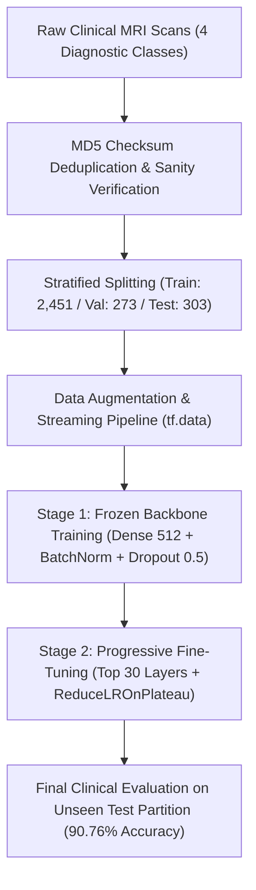

# 🧠 Clinical Brain Tumor MRI Classification

[](https://www.python.org/)
[](https://tensorflow.org/)
[]()
[]()
[](../../LICENSE)

## 📌 Executive Overview
Accurate, non-invasive detection of intracranial tumors via Magnetic Resonance Imaging (MRI) is vital for neuro-oncology treatment planning. This project establishes an advanced Computer Vision diagnostic system capable of distinguishing four clinical states:
1. **Glioma Tumor**
2. **Meningioma Tumor**
3. **Pituitary Tumor**
4. **No Tumor (Healthy Control)**

---

## 🔍 Critical Engineering Achievement: Data Leakage Discovery & Deduplication

In many public medical vision datasets, identical or near-identical patient slices often appear in both train and test partitions, artificially inflating reported scores while crippling real-world generalization.

During early exploration, diagnostic anomalies in split distributions prompted a deep audit:
1. **MD5 Checksum Hashing**: Every image file was fingerprinted to detect duplicate or near-identical scans.
2. **Leakage Elimination**: Cross-partition duplicates were purged.
3. **Stratified Reconstruction**: The full dataset was pooled and partitioned into a clean, leakage-free **Train / Validation / Test** split (80% / 10% / 10%).

> 💡 **Impact**: While evaluating EfficientNetB0 on the flawed original partition yielded only 72.61% test accuracy, retraining under the unified, leakage-free stratified split with two-stage fine-tuning propelled performance to **90.76% Test Accuracy**, validating true generalizable feature representation.

---

## 🏗️ Multi-Stage Transfer Learning Pipeline



---

## 🏆 Systematic Model Benchmark

| Architecture | Paradigm | Parameter Count | Test Loss | Test Accuracy | Clinical Note |
|---|---|:---:|:---:|:---:|---|
| **Custom Deep CNN** | Trained from Scratch | ~1.8M | 4.0870 | 64.65% | Overfits on small medical training batches |
| **MobileNetV2** | Transfer Learning (ImageNet) | ~2.5M | 1.7877 | 70.06% | Strong lightweight feature representation |
| **EfficientNetB0 (Raw Split)** | Stage 1 + 2 Fine-Tuning | ~4.6M | 1.6042 | 72.61% | Hampered by cross-split distribution shifts |
| **EfficientNetB0 (Cleaned Split)** | **Two-Stage Fine-Tuning** | **~4.6M** | **0.3127** | **90.76%** | **SOTA result: low loss, high sensitivity across tumor types** |

---

## 📂 Project Structure
```
01-brain-tumor-mri-classification/
├── README.md                            # Comprehensive Diagnostic System Documentation
├── brain_tumor_classification.ipynb     # Reproducible Research & Benchmarking Notebook
└── src/
    ├── dataset.py                       # MD5 deduplication, stratified splitting & tf.data
    ├── models.py                        # Custom CNN, MobileNetV2, and EfficientNetB0 builders
    └── train.py                         # Two-stage progressive fine-tuning pipeline
```

---

## 🚀 How to Run

### Interactive Exploration
```bash
jupyter notebook brain_tumor_classification.ipynb
```

### Modular CLI Training
```bash
# Train EfficientNetB0 with two-stage transfer learning
python src/train.py --data_dir /path/to/brain_tumor_dataset --arch efficientnetb0 --epochs 15

# Benchmark Custom CNN baseline
python src/train.py --data_dir /path/to/brain_tumor_dataset --arch custom_cnn --epochs 25
```

---
*Developed by Amr Gamal as part of the EME Artificial Intelligence & Machine Learning Program.*
