# 🎵 Audio Music Genre Classification via Mel-Spectrograms

[](https://www.python.org/)
[](https://tensorflow.org/)
[]()
[]()
[](../../LICENSE)

## 📌 Executive Overview
Automatic musical genre classification is a foundational task in Music Information Retrieval (MIR) and algorithmic recommendation systems. Rather than processing raw one-dimensional acoustic waveforms, this project maps audio dynamics into **two-dimensional Mel-Spectrogram frequency-time representations**, transforming audio analysis into a high-resolution Computer Vision classification challenge.

---

## 🎼 The 10 Musical Genres

The model is evaluated across all 10 standard GTZAN musical categories:
`Blues` • `Classical` • `Country` • `Disco` • `Hiphop` • `Jazz` • `Metal` • `Pop` • `Reggae` • `Rock`

---

## 🔬 Signal-to-Vision Pipeline Architecture

```mermaid
flowchart LR
    A["Raw Audio Signals (1,000 Tracks, 30s each)"] --> B["Short-Time Fourier Transform (STFT)"]
    B --> C["Mel-Scale Filter Bank Conversion (Mel-Spectrograms)"]
    C --> D["Stratified Partitioning (Train: 689 / Val: 148 / Test: 148)"]
    D --> E["Domain-Specific Augmentation (Preserving Temporal Direction)"]
    E --> F["Transfer Learning with MobileNetV2 + Dense Head"]
    F --> G["Fine-Tuning with Dynamic LR Decay (ReduceLROnPlateau)"]
    G --> H["10-Genre Classification (75.68% Val / 71.62% Test Accuracy)"]
```



### 🎧 Critical Audio Domain Preprocessing
- **Time Invariance**: Standard computer vision augmentations like horizontal flipping were strictly omitted because flipping time-frequency spectrograms reverses the temporal progression of audio (playing music backwards), which breaks rhythmic and harmonic patterns.
- **Normalization**: Dynamic decibel scaling normalized power variances across quiet acoustic classical passages and heavy amplified metal riffs.

---

## 🏆 Comparative Experimental Results

| Model Architecture | Training Strategy | Final Test Accuracy | Peak Validation Accuracy | Key Observation |
|---|---|:---:|:---:|---|
| **Custom Deep CNN** | Scratch Training (4 Conv Blocks) | 10.14% | 12.16% | Severely underfits; struggles to extract harmonic textures without large pretraining |
| **MobileNetV2** | **Pretrained ImageNet + Fine-Tuning** | **71.62%** | **75.68%** | **Excels at detecting harmonic contours and temporal rhythmic patterns** |

---

## 📂 Project Organization
```
02-gtzan-music-genre-classification/
├── README.md                                         # Audio ML & Spectrogram Documentation
├── music_genre_spectrogram_classification.ipynb      # Interactive Training & Evaluation Notebook
└── src/
    └── train_audio_mobilenet.py                      # Modular Spectrogram Training Pipeline
```

---

## 🚀 How to Run

### Interactive Exploration
```bash
jupyter notebook music_genre_spectrogram_classification.ipynb
```

### Modular Pipeline Execution
```bash
python src/train_audio_mobilenet.py --data_dir /path/to/gtzan_spectrograms --model_type mobilenet --epochs 30
```

---
*Developed by Amr Gamal as part of the EME Artificial Intelligence & Machine Learning Program.*
