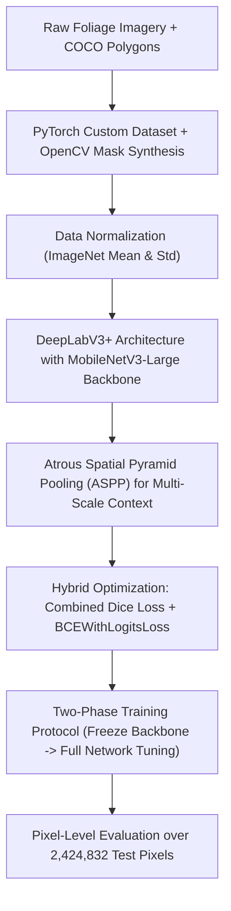

# 🌿 Precision Agriculture: Plant Leaf Semantic Segmentation

[](https://www.python.org/)
[](https://pytorch.org/)
[]()
[]()
[]()
[](../../LICENSE)

## 📌 Executive Overview
In modern smart agriculture and autonomous crop monitoring, pixel-accurate foliage segmentation is the indispensable prerequisite for detecting plant pathology, assessing canopy coverage, and guiding automated robotic sprayers. This project implements a **PyTorch Semantic Segmentation Pipeline** using **DeepLabV3+ with a MobileNetV3-Large backbone**, delivering exceptional pixel-level boundary delineation on complex agricultural backgrounds.

---

## 🔬 Dataset & Annotation Standard

Built on the curated **Clean Farmers Leaf Dataset** hosted on Kaggle by **Amr Gamal** ([`amrgamal007/verycleanfarmers`](https://www.kaggle.com/datasets/amrgamal007/verycleanfarmers)):
- **Annotation Format**: Standardized **COCO JSON polygon annotations** (`_annotations.coco.json`).
- **Data Partitions**: Formally partitioned into `Train`, `Validation`, and `Test` sets.
- **Resolution**: Normalized to $256 \times 256$ with ImageNet channel statistics.

---

## 🏗️ Model Architecture & Optimization Strategy



### 🎯 Hybrid Loss Formulation
Segmentation models trained solely with standard cross-entropy suffer from pixel imbalance between vast background areas and intricate leaf contours. We implemented a **Combined Dice + Binary Cross-Entropy Loss**:
$$\mathcal{L}_{\text{total}} = 0.5 \cdot \mathcal{L}_{\text{BCE}} + 0.5 \cdot \mathcal{L}_{\text{Dice}}$$
This directly optimizes both global cross-entropy and area-level boundary overlap.

---

## 🏆 Unseen Test Set Evaluation Results

Evaluated across $n = 37$ independent test scenes comprising **2,424,832 ground-truth pixels**:

| Evaluation Metric | Test Set Performance | Benchmark Interpretation |
|---|:---:|---|
| **Dice Coefficient (F1)** | **0.9807 (98.07%)** | Near-perfect overlap between ground-truth and predicted leaf masks |
| **Intersection over Union (IoU)** | **0.9621 (96.21%)** | Outstanding spatial boundary agreement (Jaccard index) |
| **Pixel Accuracy** | **0.9814 (98.14%)** | 98.14% of all test pixels classified correctly |
| **Precision** | **0.9797 (97.97%)** | Negligible false positive foliage predictions |
| **Recall (Sensitivity)** | **0.9817 (98.17%)** | Captures thin leaf tips, stems, and edge margins |
| **Test Loss** | **0.0722** | Robust convergence without overfitting |

### Detailed Class-Wise Breakdown
```
              precision    recall  f1-score   support (pixels)

  Background     0.9825    0.9809    0.9817         1,236,055
        Leaf     0.9802    0.9819    0.9810         1,188,777

    accuracy                         0.9814         2,424,832
   macro avg     0.9814    0.9814    0.9814         2,424,832
weighted avg     0.9814    0.9814    0.9814         2,424,832
```

---

## 📂 Project Organization
```
03-plant-leaf-semantic-segmentation/
├── README.md                                    # Detailed Technical & Agronomic Documentation
├── leaf_semantic_segmentation_deeplabv3.ipynb   # Full PyTorch Training & Visualization Notebook
└── src/
    ├── dataset_coco.py                          # PyTorch Dataset parsing COCO annotations
    ├── model_deeplabv3.py                       # DeepLabV3+ architecture & Combined Dice Loss
    └── train_segmentation.py                    # Modular training, validation & metric evaluation
```

---

## 🚀 How to Run

### Interactive Notebook
```bash
jupyter notebook leaf_semantic_segmentation_deeplabv3.ipynb
```

### Production Training Pipeline
```bash
python src/train_segmentation.py --data_dir /path/to/verycleanfarmers --epochs 10 --batch_size 8
```

---
*Developed by Amr Gamal as part of the EME Artificial Intelligence & Machine Learning Program.*
